# AyudaCampus

Aplicación Android del Laboratorio 08 de Programación en Móviles. Es una mesa de ayuda para registrar y atender incidencias del campus desde dos perfiles: **Estudiante** y **Soporte TI**.

## Objetivo

Aplicar Kotlin, Jetpack Compose, MVVM, Repository, Room y DataStore en un flujo completo: crear una solicitud, atenderla, conversar sobre el problema y cerrar la atención con una calificación.

## Tecnologías

| Componente | Configuración del proyecto |
| --- | --- |
| Lenguaje | Kotlin 1.9.20 |
| Interfaz | Jetpack Compose, BOM 2023.10.01 y Material 3 |
| Compilador de Compose | 1.5.4 |
| Arquitectura | ViewModel, StateFlow y corrutinas; Lifecycle 2.7.0 |
| Persistencia del negocio | Room 2.6.1 |
| Generación de código | KSP 1.9.20-1.0.14 |
| Preferencias | Preferences DataStore 1.0.0 |
| Navegación | Navigation Compose 2.7.6 |
| Compilación | Android Gradle Plugin 8.2.0 y Gradle Wrapper 8.4 |
| SDK | compileSdk / targetSdk 34; minSdk 24 |
| Package y Application ID | `com.tecsup.ayudacampus` |

## Arquitectura MVVM

Las pantallas muestran el estado y envían acciones al ViewModel. Las validaciones y reglas de estado están en los ViewModels. Estos utilizan la interfaz `AyudaRepository`; `AyudaRepositoryRoom` delega el acceso a los DAO. Las consultas de Room emiten `Flow`, por lo que listas, detalles y contadores se actualizan al cambiar los registros.

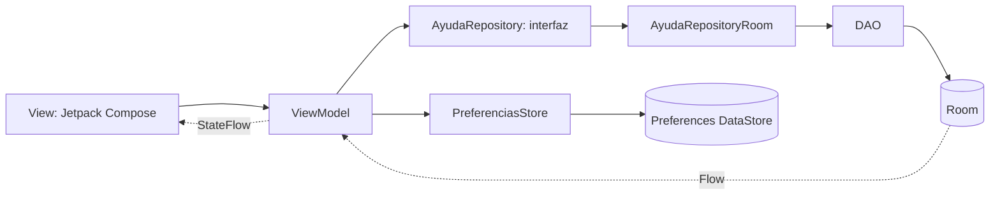

`NavAyuda` conecta las pantallas y entrega las dependencias a las fábricas de ViewModel. Los Composables no ejecutan consultas de DAO ni operaciones de negocio del Repository. `AyudaApp` mantiene las instancias compartidas de base de datos, Repository y preferencias.

## Estructura

El proyecto Android que se debe abrir es **esta carpeta `Semana 08`**.

```text
Semana 08/
├── app/
│   └── src/
│       ├── main/
│       │   ├── AndroidManifest.xml
│       │   └── java/com/tecsup/ayudacampus/
│       │       ├── MainActivity.kt
│       │       ├── AyudaApp.kt
│       │       ├── data/
│       │       │   ├── local/
│       │       │   │   ├── AyudaDatabase.kt
│       │       │   │   ├── DatosIniciales.kt
│       │       │   │   ├── entity/     # Categoria, Usuario, Ticket, Comentario
│       │       │   │   ├── dao/        # CategoriaDao, UsuarioDao, TicketDao
│       │       │   │   └── relation/   # TicketConDetalle
│       │       │   ├── repository/    # Interfaz e implementación Room
│       │       │   └── prefs/         # PreferenciasStore
│       │       ├── model/             # Enums y modelos de conteos/gráficos
│       │       ├── viewmodel/         # Sesión, listas, formularios, detalle, soporte y perfil
│       │       └── ui/
│       │           ├── cliente/
│       │           ├── soporte/
│       │           ├── components/graficos/
│       │           ├── navigation/
│       │           └── theme/
│       └── androidTest/               # Integración con Room/DataStore e interfaz
├── capturas/
├── gradle/wrapper/
├── build.gradle.kts
├── settings.gradle.kts
├── gradlew
└── gradlew.bat
```

La entrada activa es `com.tecsup.ayudacampus.MainActivity`, registrada en el Manifest. Se conserva un archivo de la plantilla original bajo `com/example/semana08`; no está registrado como Activity ni es un destino de navegación.

## Funcionalidades del estudiante

- Login con validación de correo, contraseña y perfil; recuperación de sesión al abrir la aplicación.
- Lista de sus propios tickets, búsqueda por título o número y filtros Todos, Abiertos, En proceso y Resueltos. Todos incluye también los cerrados.
- Creación de tickets con categoría activa, título, descripción, ubicación y prioridad. Se validan los campos y se bloquean envíos repetidos durante el guardado.
- Detalle con categoría, estado, prioridad, fecha e historial de comentarios.
- Comentarios mientras el ticket no esté cerrado.
- Cierre de un ticket resuelto con calificación obligatoria de 1 a 5 estrellas, o reapertura de un resuelto como Abierto.
- Perfil con datos del usuario y contadores de tickets abiertos, resueltos y totales.
- Preferencias de modo oscuro y notificaciones; cierre de sesión con confirmación.

## Funcionalidades del soporte

- Login y recuperación de sesión con perfil ADMIN.
- Panel con contadores por estado, gráfico de dona por estado y barras por categoría. La alerta cuenta las solicitudes ALTA y ABIERTAS con más de una hora.
- Bandeja de todos los estudiantes, ordenada por prioridad y fecha, con búsqueda por título, número o estudiante y filtros por estado y prioridad.
- Atención del ticket: datos completos, respuestas con el usuario ADMIN autenticado y selección de estado y prioridad mediante **Guardar cambios**.
- Estados permitidos: ABIERTO, EN_PROCESO y RESUELTO. CERRADO está deshabilitado; el cierre con calificación corresponde al estudiante. Los tickets cerrados son de solo lectura.
- Categorías: listado, creación, edición, seis iconos, activación y eliminación con confirmación. Se rechazan nombres vacíos o duplicados y la eliminación de categorías que tienen tickets.
- Perfil y ajustes con modo oscuro, notificaciones y **Recibir tickets**. Al apagar esta última opción, el estudiante ve **Mesa de ayuda cerrada** y no puede crear solicitudes, incluso desde un formulario que ya tenía abierto.

En ambos perfiles existe un botón explícito de **modo práctica** para cambiar al usuario de demostración del otro rol sin volver a ingresar credenciales. Se guarda el usuario real de Room y se limpia la pila de navegación. Esto es parte del laboratorio; no equivale a una autorización de soporte para una aplicación de producción.

## Room y DataStore

Room guarda los datos del negocio en `ayudacampus.db`, versión 1: `categorias`, `usuarios`, `tickets` y `comentarios`. Las claves foráneas conservan las relaciones y los comentarios se eliminan en cascada al eliminar su ticket. La siembra inicial usa una transacción y solo se ejecuta si no existen usuarios: cinco categorías, dos usuarios, seis tickets y cuatro comentarios.

DataStore usa un único archivo `ajustes` para `perfilActivo`, `usuarioId`, `modoOscuro`, `notificaciones` y `recibirTickets`. Sus valores se observan mediante Flow. No almacena contraseñas, tickets ni comentarios. Cerrar sesión limpia únicamente el perfil y el ID, conservando las tres preferencias.

## Credenciales de demostración

| Perfil | Correo | Contraseña |
| --- | --- | --- |
| Estudiante | `juan@campus.test` | `1234` |
| Soporte TI | `soporte@campus.test` | `admin` |

Son cuentas locales de prueba incluidas en los datos iniciales, no credenciales privadas de un servicio.

## Requisitos y apertura en Android Studio

1. Tener Android Studio con JDK 17 y Android SDK Platform 34 instalado. El dispositivo o emulador debe usar Android 7.0 / API 24 o superior.
2. En Android Studio, elegir **Open** y seleccionar `Semana 08`, donde está `settings.gradle.kts`. No abrir una carpeta duplicada dentro de ella.
3. Configurar **Gradle JDK** con JDK 17 y esperar la sincronización de Gradle. Se necesita Internet para descargar dependencias que todavía no estén en la caché.
4. Configurar el SDK desde Android Studio. `local.properties` contiene una ruta propia de cada computadora y no se sube al repositorio.
5. Seleccionar el módulo `app` y un dispositivo. Pulsar **Run** e ingresar con una de las cuentas de demostración.

## Compilar y probar desde Windows

Abrir una terminal en `Semana 08`. Si Java no está configurado, establecer `JAVA_HOME` con la ruta del JDK 17 instalado.

```powershell
# Compilación limpia
.\gradlew.bat :app:clean :app:assembleDebug

# Pruebas instrumentadas: requiere emulador o dispositivo conectado
.\gradlew.bat :app:connectedDebugAndroidTest

# Pruebas unitarias locales, si hay fuentes en src/test
.\gradlew.bat :app:testDebugUnitTest

# Instalar la versión de depuración en el dispositivo conectado
.\gradlew.bat :app:installDebug
```

El APK se genera en `app/build/outputs/apk/debug/app-debug.apk`. Las pruebas instrumentadas generan su informe HTML en `app/build/reports/androidTests/connected/debug/index.html` y XML en `app/build/outputs/androidTest-results/connected/debug/`. Son archivos generados y están excluidos de Git.

## Verificación final del Paso 13

Verificación realizada el **24 de octubre de 2026**, con JDK 17, Gradle Wrapper 8.4 y el emulador **Medium_Phone, API 37**.

| Ejecución | Resultado real |
| --- | --- |
| `:app:clean :app:assembleDebug` | BUILD SUCCESSFUL; compilación limpia y generación de Room mediante KSP |
| `:app:connectedDebugAndroidTest` | **56 pruebas aprobadas**, 0 fallos, 0 errores y 0 omitidas |
| `:app:testDebugUnitTest` | Tarea ejecutada con resultado **NO-SOURCE**: no existen pruebas locales en `src/test`; no se cuentan como pruebas aprobadas |

Distribución de las 56 pruebas instrumentadas, comprobada en el informe XML:

| Clase | Pruebas aprobadas |
| --- | ---: |
| AyudaRepositoryRoomTest | 2 |
| SesionViewModelTest | 3 |
| MisTicketsViewModelTest | 2 |
| NuevoTicketViewModelTest | 4 |
| DetalleTicketViewModelTest | 7 |
| PanelViewModelTest | 7 |
| GestionSoporteViewModelTest | 12 |
| PerfilPreferenciasTest | 6 |
| SesionLoginTest | 13 |
| **Total** | **56** |

Comprobaciones funcionales realizadas:

| Caso de aceptación | Verificación ejecutada |
| --- | --- |
| Login de ambos perfiles, clave incorrecta y rol incorrecto | SesionViewModelTest y SesionLoginTest |
| Recuperación de sesión y limpieza de sesiones inválidas | SesionViewModelTest y pruebas de reapertura de Activity en SesionLoginTest |
| Crear vacío, validar categoría activa y guardar sin duplicados | NuevoTicketViewModelTest y SesionLoginTest |
| Mis Tickets: solo datos del estudiante, búsqueda, filtros y cerrados en Todos | MisTicketsViewModelTest y SesionLoginTest |
| Bandeja: búsqueda por estudiante, número y título; filtros y orden de prioridad | PanelViewModelTest, AyudaRepositoryRoomTest y SesionLoginTest |
| Respuestas del soporte y comentarios del estudiante con autor real | GestionSoporteViewModelTest, DetalleTicketViewModelTest y SesionLoginTest |
| Cambio de estado y prioridad, actualización de Room y panel | GestionSoporteViewModelTest y pruebas de interfaz de soporte |
| Opción CERRADO deshabilitada para soporte | Prueba de interfaz de atención y pruebas de reglas de ambos ViewModels |
| Resolver, reabrir y limpiar datos de cierre, luego cerrar con cuatro estrellas | Recorrido completo `aceptacionFinalCicloCompletoEntreEstudianteYSoporte` y DetalleTicketViewModelTest |
| Ticket cerrado sin campo de comentario ni nuevos cambios permitidos | Pruebas de cierre de interfaz y ViewModels de detalle y atención |
| Categorías: crear, editar, activar, duplicados, confirmación y protección de relaciones | GestionSoporteViewModelTest y prueba de interfaz de categorías |
| Categoría inactiva oculta en creación, conservada en tickets anteriores | Pruebas de integración de categorías y formulario Nuevo Ticket |
| Indicadores, datos de gráficos, categorías sin tickets y alerta por antigüedad | PanelViewModelTest y prueba de interfaz del panel |
| Perfil, modo oscuro, notificaciones y recepción de tickets | PerfilPreferenciasTest y pruebas de interfaz de ambos perfiles |
| Cierre con confirmación, conservación de preferencias y limpieza de la pila | SesionLoginTest, SesionViewModelTest y PerfilPreferenciasTest |
| Rutas manipuladas bloqueadas para el otro rol y para una sesión ausente | `rutasManipuladasNoAbrenPantallasDelOtroRol` y pruebas de autorización de los ViewModels |

El recorrido de aceptación crea su propio ticket desde la interfaz del estudiante, cambia al soporte para atenderlo y responder, vuelve al estudiante para reabrirlo y termina con resolución y cierre calificado. Se ejecutó sin reiniciar el proceso entre esos cambios y retiró únicamente su registro de prueba al finalizar.

Además, se realizó una comprobación independiente desde la interfaz con **detención completa del proceso** y apertura posterior: el PID cambió de 4432 a 4860, se recuperó la sesión del estudiante, continuaron visibles los tickets y se conservaron modo oscuro activado y notificaciones desactivadas. Al finalizar se restauraron las preferencias originales y se cerró la sesión. Esta comprobación adicional no se suma al conteo de 56 pruebas instrumentadas.

La revisión estática confirmó que no hay consultas DAO desde Composables, que los ViewModels dependen de `AyudaRepository`, que no quedan destinos temporales y que las claves de DataStore no incluyen contraseñas. Git no rastrea `build/`, `.gradle/`, `.idea/`, `local.properties`, resultados generados ni la carpeta duplicada `Semana 08/Semana 08`.


Las pruebas de interfaz usan la accesibilidad pública de Android para trabajar en el emulador API 37, donde las reglas antiguas de Espresso dependen de una API oculta que ya no está disponible. Las pruebas de integración utilizan Room y DataStore reales; no reemplazan sus datos con listas estáticas.

## Capturas reales

Estas imágenes se obtuvieron del emulador durante las verificaciones de los pasos indicados en sus nombres. Algunas muestran registros temporales utilizados por las pruebas; esos registros se retiran al terminar cada prueba. No son imágenes generadas ni implican que todas las capturas pertenezcan a la misma sesión.

### Estudiante

| Login | Mis Tickets | Nuevo Ticket |
| --- | --- | --- |
| 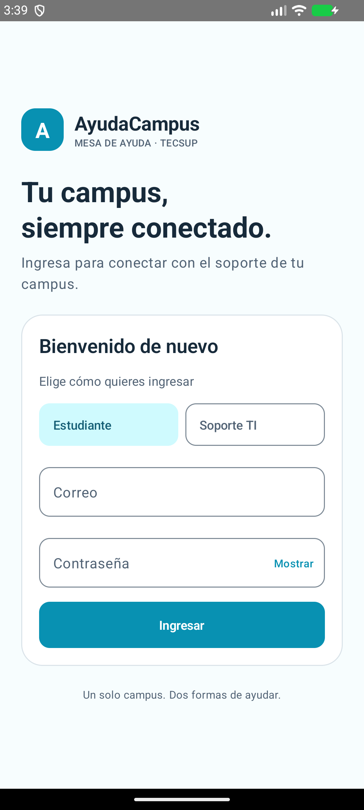 | 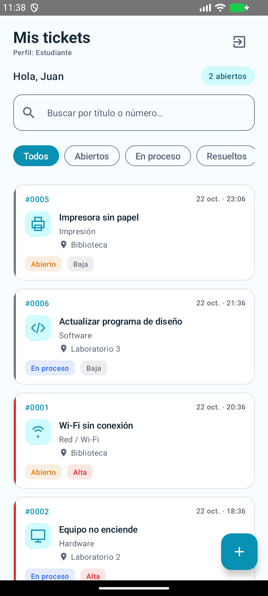 | 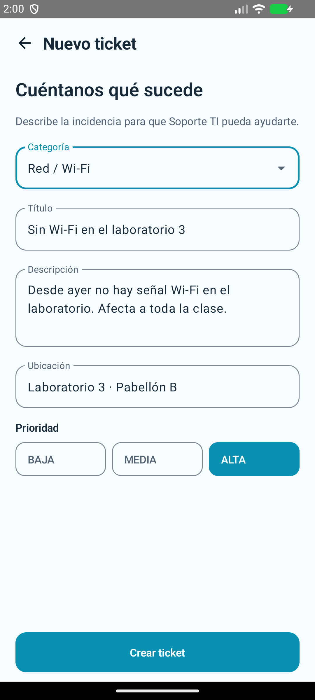 |

| Detalle y cierre | Perfil | Perfil después de reiniciar el proceso |
| --- | --- | --- |
| 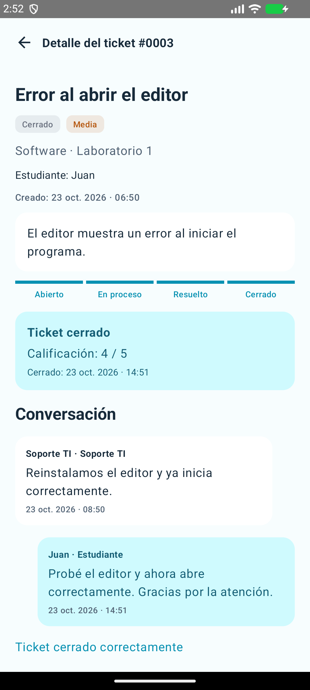 | 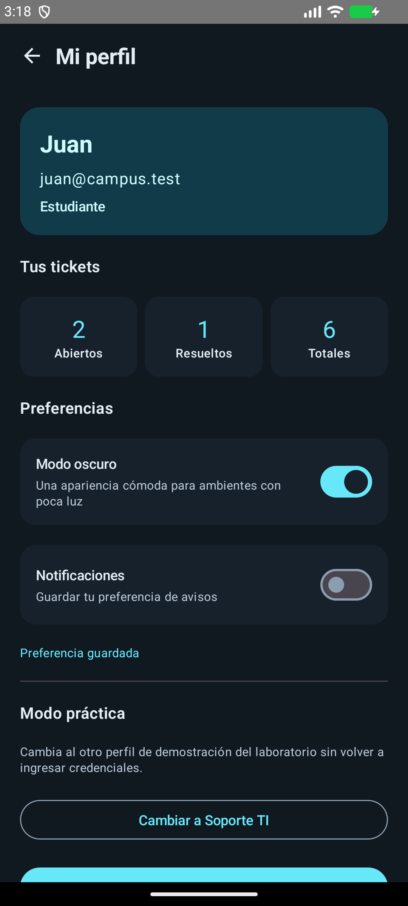 | 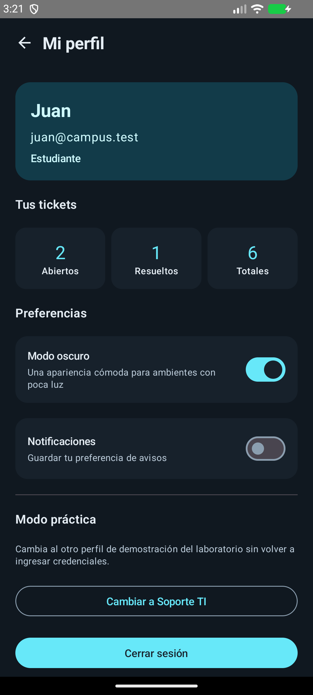 |

### Soporte TI

| Panel e indicadores | Bandeja | Atención |
| --- | --- | --- |
| 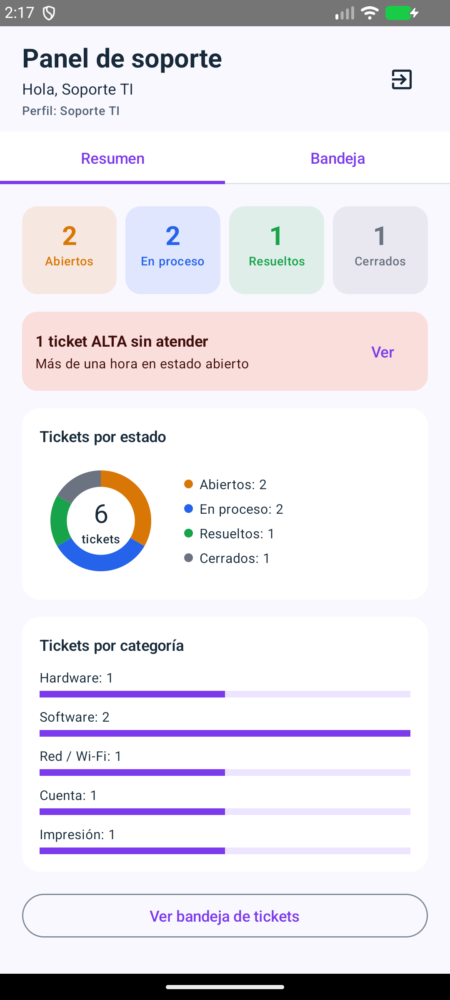 | 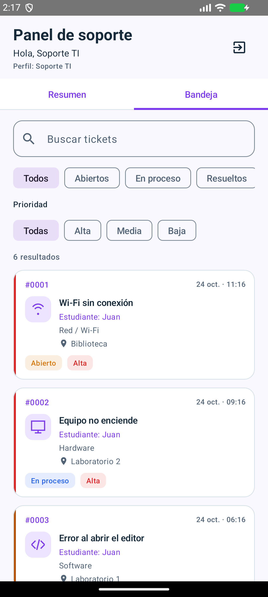 | 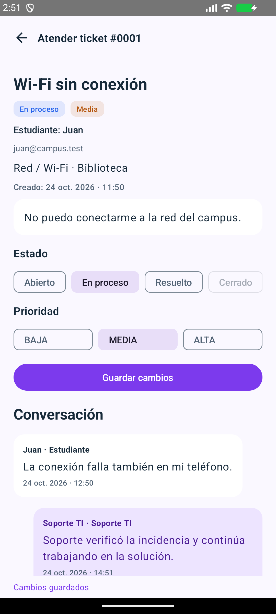 |

| Categorías | Formulario de categoría | Perfil y ajustes |
| --- | --- | --- |
| 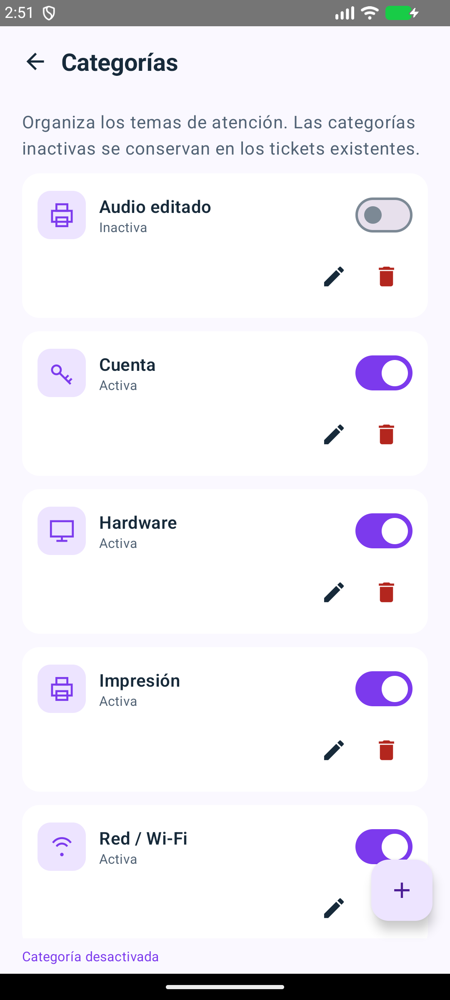 | 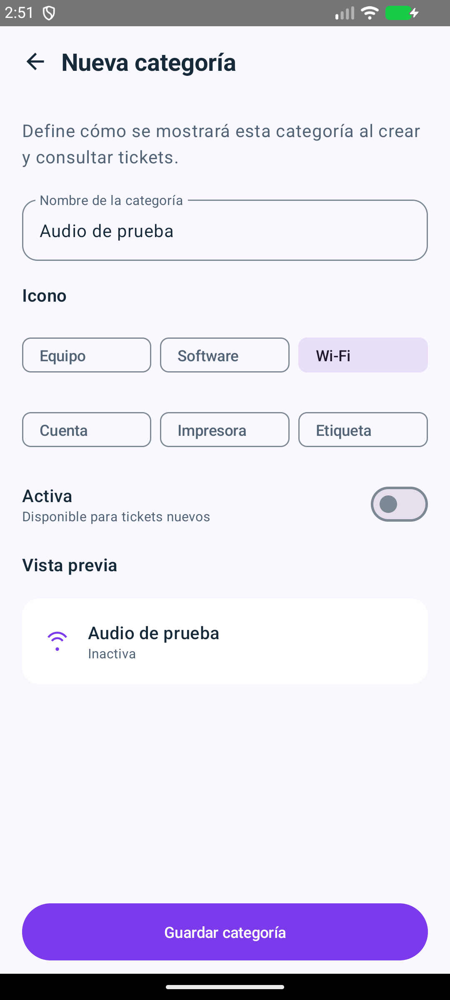 | 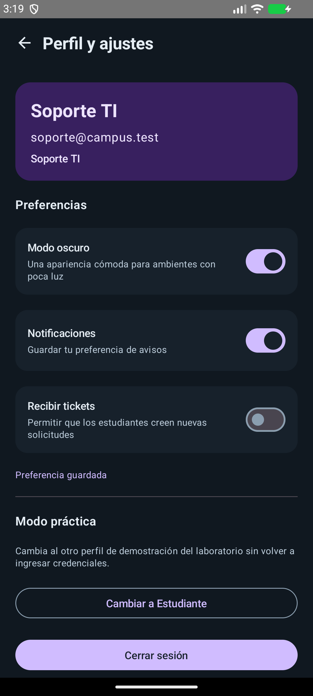 |

## Limitaciones conocidas

- Es una aplicación local de laboratorio: no tiene servidor, sincronización entre celulares ni registro de cuentas nuevas.
- Las contraseñas de demostración se guardan en Room según el contrato del laboratorio; esta autenticación y el cambio de perfil de práctica no son un sistema de seguridad para producción.
- El interruptor de notificaciones conserva una preferencia; no se implementó un servicio de notificaciones push o en segundo plano.
- Recibir tickets controla la mesa de ayuda en esta instalación. Compartir ese estado entre dispositivos requiere un backend.
- La verificación se realizó en el emulador indicado arriba; no se afirma cobertura de todos los tamaños de pantalla ni de dispositivos físicos.

## Para pensar

- Las reglas de estado van en el ViewModel para validar las acciones sin mezclar la interfaz con las consultas de almacenamiento.
- `crearTicket` es `suspend` porque guarda una vez sin bloquear la interfaz; `observarTicket` es Flow porque debe emitir cada cambio.
- Cerrar sin calificación dejaría incompleta la evaluación de la atención y rompería la regla de cierre del laboratorio.
- Con un servidor, se agregaría otra implementación del Repository y una fuente remota; el servidor también tendría que validar permisos y estados.

## Historial y alcance de esta entrega

Se conserva el historial real de AyudaCampus, incluidos sus dos primeros commits y los commits de consolidación, pruebas y funcionalidades posteriores. La distribución de esos commits no reproduce uno por uno el orden sugerido en el PDF. El trabajo se hizo con asistencia de IA en esta conversación; no se presenta como un historial realizado sin IA.

Este cierre corresponde al Paso 13 de la implementación principal. No incluye push ni la rama `mejora-ia`; la fase de mejoras requiere una autorización posterior.


## Fase 2: rediseño visual con IA

La rama `mejora-ia` incorpora la modernización visual por rol y la navegación inferior sin cambiar la capa de datos. Consulta el [registro del rediseño](REDISENO_IA.md), los [prompts y decisiones asistidas](PROMPTS.md) y las [capturas reales por perfil y modo](capturas/fase2/README.md). El resultado final de pruebas se documenta en el registro del rediseño; esta fase no se publica sin autorización.
