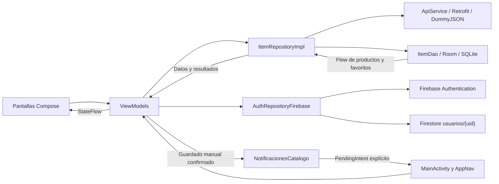

# Arquitectura de SmartCatalog

MVVM separa la interfaz de las operaciones de datos. `MainActivity` compone el tema y `AppNav`. `SmartCatalogApplication` mantiene el `AppContainer` que proporciona repositorios y fábricas de ViewModels. Las pantallas de Compose observan estados con el ciclo de vida y envían acciones al ViewModel.

| ViewModel | Responsabilidad |
| --- | --- |
| `SesionViewModel` | Validación inicial, login, estados de sesión y logout |
| `ListaViewModel` | Observa Room, actualiza el catálogo y alterna favoritos |
| `DetalleViewModel` | Consulta el detalle, distingue origen remoto y local y refleja el favorito |
| `FavoritosViewModel` | Observa favoritos locales y permite quitarlos |
| `PanelAdminViewModel` | Contadores reactivos, sincronización manual, limpieza de imágenes y envío del aviso |

`ItemRepositoryImpl` combina `ApiService` y `ItemDao`. Retrofit convierte JSON a DTO y los mapeadores producen modelos y entidades. Room emite cambios mediante Flow. Las pantallas usan estados de carga, éxito y error, junto con estados específicos de sincronización y sesión. Los repositorios alternativos de etapas anteriores y los proveedores simulados no son el camino de producción.

`AppNav` monta las rutas protegidas después de validar la sesión. `AccesoRutas` comprueba el rol al navegar y al componer el destino. Las acciones del panel también comprueban el rol vigente. Al salir, se descarta la pila protegida. Los avisos abren la actividad principal con una pila nueva y vuelven a pasar por la validación. [Firebase](FIREBASE_CONFIGURACION.md) · [Notificaciones](NOTIFICACIONES.md)
