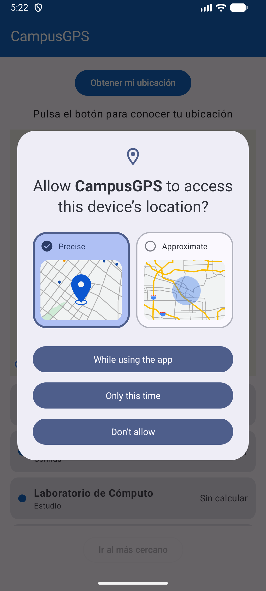
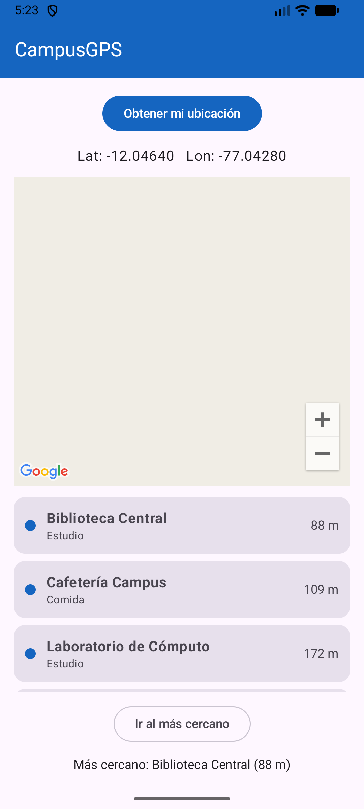
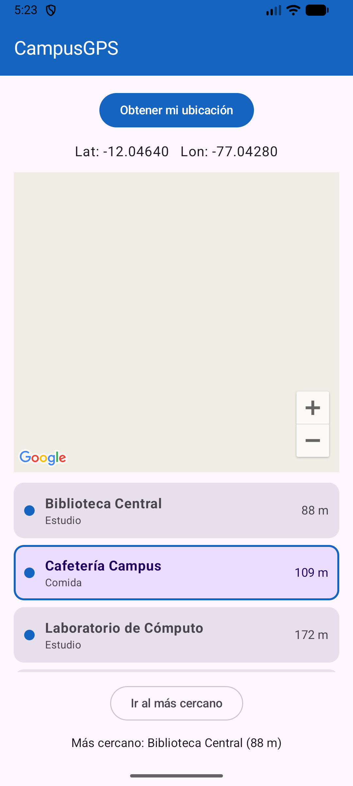
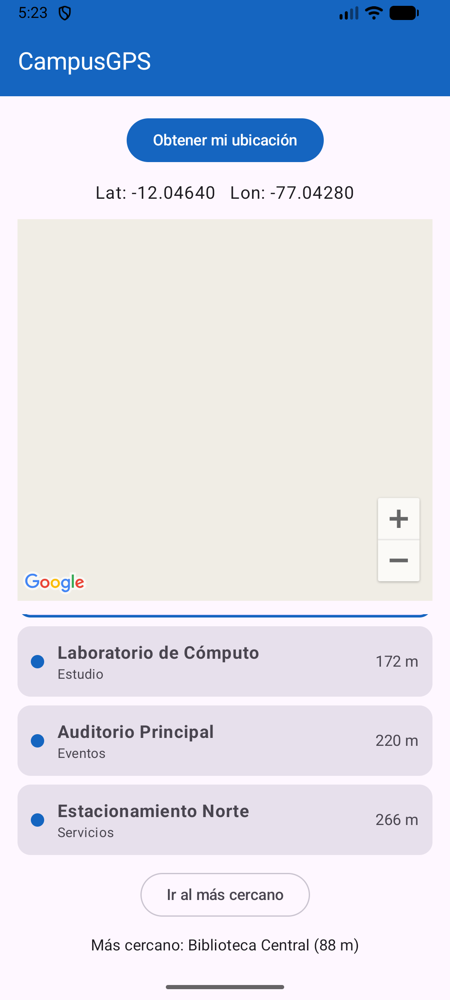
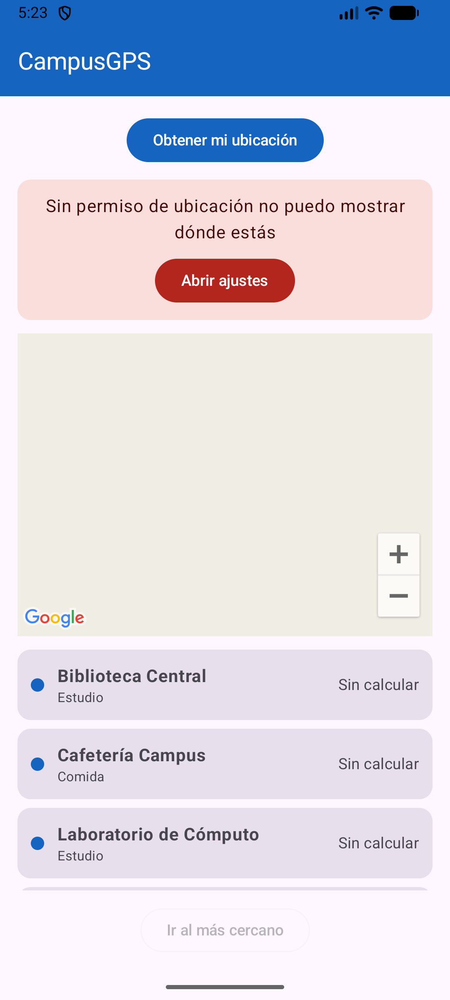
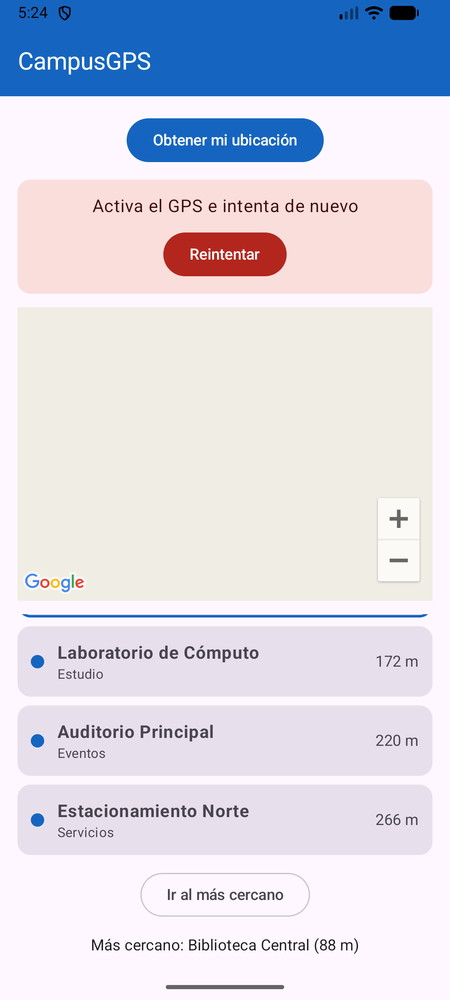

# CampusGPS

App Android que obtiene la ubicación del celular, la muestra en un mapa y dice qué lugar del campus está más cerca. Muestra cinco puntos ficticios (biblioteca, cafetería, laboratorio, auditorio y estacionamiento) con su distancia en metros, ordenados del más cercano al más lejano.

**Tecnología:** Kotlin + Jetpack Compose + Material 3 (sin XML), Google Play Services Location, Maps Compose.
**Patrón:** MVVM + Repository (interface).
**Curso:** Programación en Móviles · Semana 13 · Localización Geográfica.

> **Nota sobre la clave de Google Maps**
> La clave de API no se configuró: Google Cloud exige registrar una tarjeta para activar Maps SDK for Android y, como indica la guía para este caso, se coordinará con el docente.
> El código ya está listo para usarla (Paso 1): `app/build.gradle.kts` lee `MAPS_API_KEY` desde `local.properties` y la inyecta en el Manifest con `manifestPlaceholders`. Por eso, en las capturas el mapa aparece en gris y sin marcadores. La ubicación, las distancias, la lista, la selección, el botón al más cercano y los errores funcionan con normalidad.
> Para ver el mapa basta con agregar `MAPS_API_KEY=...` en `local.properties` (archivo ignorado por git) y volver a compilar.

## Estructura de paquetes

```
com.tecsup.campusgps/
├── MainActivity.kt
├── model/
│   └── Modelos.kt                    Posicion, Lugar, LugarConDistancia, UbicacionUi, TipoError
├── data/
│   ├── UbicacionRepository.kt        interface + UbicacionNoDisponibleException
│   ├── UbicacionRepositoryGoogle.kt  implementación con FusedLocationProviderClient
│   ├── LugaresRepository.kt          interface
│   └── LugaresRepositoryLocal.kt     los 5 lugares fijos
├── util/
│   ├── Distancia.kt                  distanciaMetros() con Location.distanceBetween
│   └── Formato.kt                    formatearDistancia() -> "350 m" / "1.5 km"
├── viewmodel/
│   ├── MapaViewModel.kt              estado, lugares, seleccionado, masCercano
│   └── CampusViewModelFactory.kt     crea el ViewModel con sus repositorios
└── ui/
    ├── PantallaMapa.kt               pantalla principal y permisos
    ├── MapaUbicacion.kt              GoogleMap, cámara y marcadores
    ├── ListaLugares.kt               tarjetas con distancia y selección
    ├── MensajeError.kt               error con Abrir ajustes / Reintentar
    └── theme/                        colores y tema Material 3
```

## Arquitectura MVVM + Repository

```
View (PantallaMapa, MapaUbicacion, ListaLugares, MensajeError)
   |  evento: pulsar el botón / tocar una tarjeta      ^  collectAsStateWithLifecycle()
   v                                                    |
ViewModel (MapaViewModel) ------- StateFlow ------------+
   |  llama solo a las interfaces
   v
UbicacionRepository ---> UbicacionRepositoryGoogle (FusedLocationProviderClient)
LugaresRepository   ---> LugaresRepositoryLocal (los 5 lugares fijos)

util/ (funciones puras): distanciaMetros(), formatearDistancia()
```

| Capa | Conoce a | No debe |
|---|---|---|
| View (`ui/`) | Solo a su ViewModel | Usar Repository, FusedLocationProviderClient ni calcular distancias |
| ViewModel | Solo a las interfaces de Repository | Conocer Composables ni recibir un `Context` |
| Repository | Google Play Services (en la implementación) | Exponer clases de UI |
| `util/` | Funciones puras | Guardar estado |

## Capturas

Emulador con Google Play, ubicación en el punto base `-12.0464, -77.0428`.

| 1. Permiso | 2. Mi ubicación | 3. Selección en la lista |
|---|---|---|
|  |  |  |

| 4. Lista ordenada | 5. Error: permiso denegado | Extra: GPS apagado |
|---|---|---|
|  |  |  |

Distancias obtenidas en el punto base: Biblioteca Central 88 m, Cafetería Campus 109 m, Laboratorio de Cómputo 172 m, Auditorio Principal 220 m, Estacionamiento Norte 266 m.

## Pruebas de aceptación

| Prueba | Resultado esperado | OK |
|---|---|---|
| Abrir la app por primera vez y pulsar el botón | Aparece el cuadro de permiso | ✅ |
| Aceptar el permiso | Se ven latitud, longitud y el marcador «Estás aquí» | ✅ latitud y longitud · marcador pendiente de clave |
| Negar el permiso | Mensaje de error con Abrir ajustes, la app no se cierra | ✅ |
| Ubicación en el punto base | Los 5 marcadores azules aparecen cerca de tu posición | ⏳ pendiente de clave de Maps |
| Tocar un marcador | Se ve el nombre y la categoría del lugar | ⏳ pendiente de clave de Maps |
| Lista de lugares | Ordenada de menor a mayor distancia, con m o km | ✅ |
| Tocar una tarjeta de la lista | La cámara viaja a ese lugar y la tarjeta queda resaltada | ✅ tarjeta resaltada · cámara pendiente de clave |
| Ir al más cercano | La cámara va al lugar verde; el botón está deshabilitado antes de buscar | ✅ botón deshabilitado antes de buscar |
| Cambiar la ubicación del emulador y buscar otra vez | Las distancias, el orden y el lugar verde se actualizan | ✅ |
| Ubicación apagada | Mensaje de GPS con Reintentar | ✅ |
| Rotar la pantalla | No se pierden la ubicación ni la lista | ✅ |
| Revisar el repositorio | `git grep` no encuentra la clave y `local.properties` no está subido | ✅ |

## Para pensar

**1. ¿Por qué `FusedLocationProviderClient` está dentro del Repository y no en el ViewModel?**
Porque es un detalle de *cómo* se obtiene la ubicación (Google Play Services) y necesita un `Context`. El ViewModel solo conoce la interfaz `UbicacionRepository`, así no depende de Android ni de Google, no recibe un `Context` (que podría filtrar memoria al sobrevivir a la Activity) y se podría probar con un repositorio falso o cambiar la fuente de ubicación sin tocar el ViewModel.

**2. ¿Qué diferencia hay entre el permiso de ubicación y la clave de API de Maps? ¿Qué pasa si falta cada uno?**
El permiso lo concede el **usuario** en tiempo de ejecución y permite leer el GPS del celular. La clave la entrega **Google Cloud** al desarrollador y autoriza a la app a usar el servicio de mapas. Sin permiso, no hay ubicación: la app muestra el error con «Abrir ajustes», pero el mapa sí se ve. Sin clave, sí hay ubicación, distancias y lista, pero el mapa sale gris y sin marcadores (es lo que ocurre en las capturas de este proyecto).

**3. ¿Por qué la clave va en `local.properties` y no en el código? ¿Qué harías si se subiera a GitHub por error?**
Porque `local.properties` está en `.gitignore` y nunca se sube al repositorio; Gradle la lee al compilar y la inyecta en el Manifest con `manifestPlaceholders`. Si estuviera en el código, cualquiera que vea el repositorio podría usarla y generar cargos. Si se subiera por error: eliminar esa clave en Google Cloud y crear una nueva (la anterior ya no es segura aunque se borre el commit), restringir la nueva al paquete y a la huella SHA-1, y revisar el `.gitignore`.

**4. ¿Dónde calculas la distancia y por qué no en el Composable?**
En `util/Distancia.kt` (función pura con `Location.distanceBetween`), y la usa el ViewModel en `actualizarDistancias()` solo cuando llega una ubicación. No va en el Composable porque los Composables se recomponen muchas veces: recalcularía en cada recomposición, mezclaría lógica con dibujo y rompería MVVM. La pantalla solo dibuja la lista ya ordenada que recibe.

**5. ¿Qué pasa con tu app si el usuario niega el permiso dos veces? ¿Cómo lo manejas?**
A partir de la segunda negación Android deja de mostrar el cuadro de permiso: `launch()` devuelve "denegado" al instante. La app no se cierra: llama a `vm.permisoDenegado()` y muestra el error con el botón **Abrir ajustes**, que abre la pantalla de la app en Ajustes (`Settings.ACTION_APPLICATION_DETAILS_SETTINGS`) para que el usuario active el permiso manualmente. Al volver y pulsar el botón, `checkSelfPermission` detecta el permiso y busca directamente.

## Cómo ejecutar

1. Abrir la carpeta `Semana 13` en Android Studio y sincronizar Gradle (AGP 9.2.1, Kotlin 2.4.10, compileSdk 37).
2. (Opcional) Agregar `MAPS_API_KEY=...` en `local.properties` para ver el mapa.
3. Ejecutar en un emulador con Google Play y poner la ubicación en `-12.0464, -77.0428` (Extended controls → Location → Set location).
