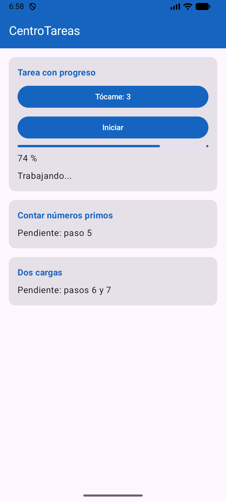
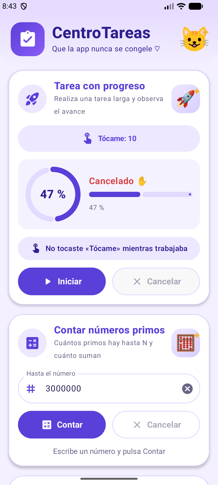
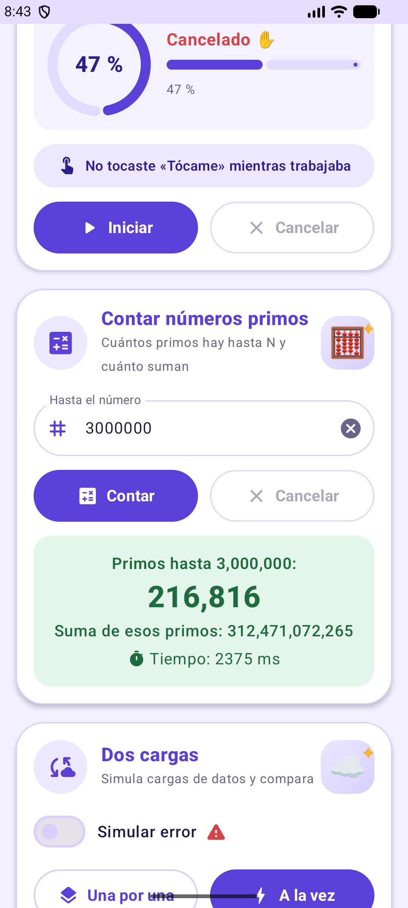
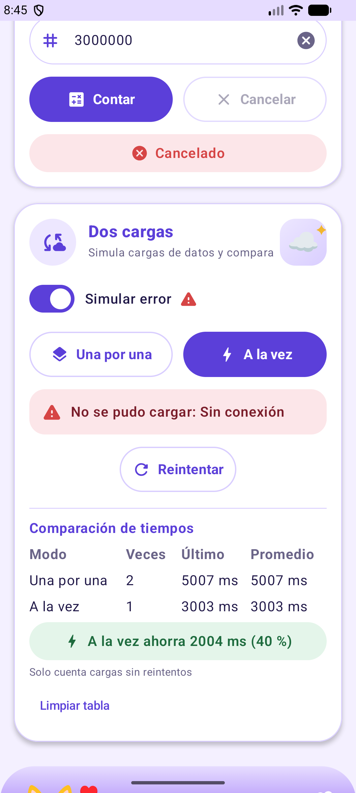
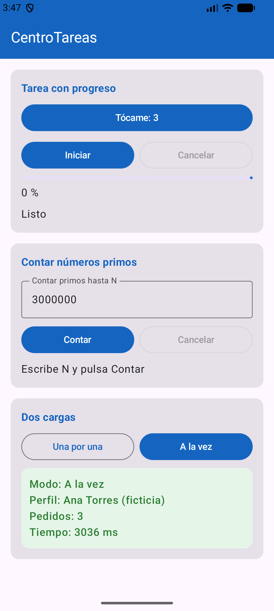
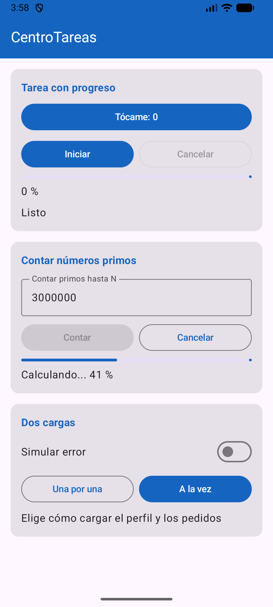
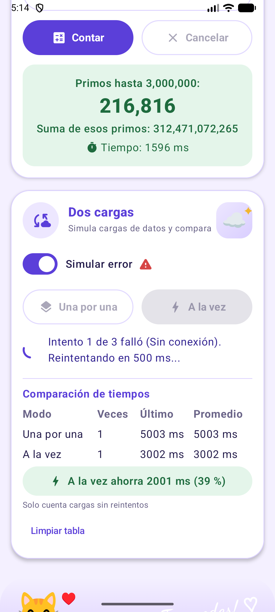
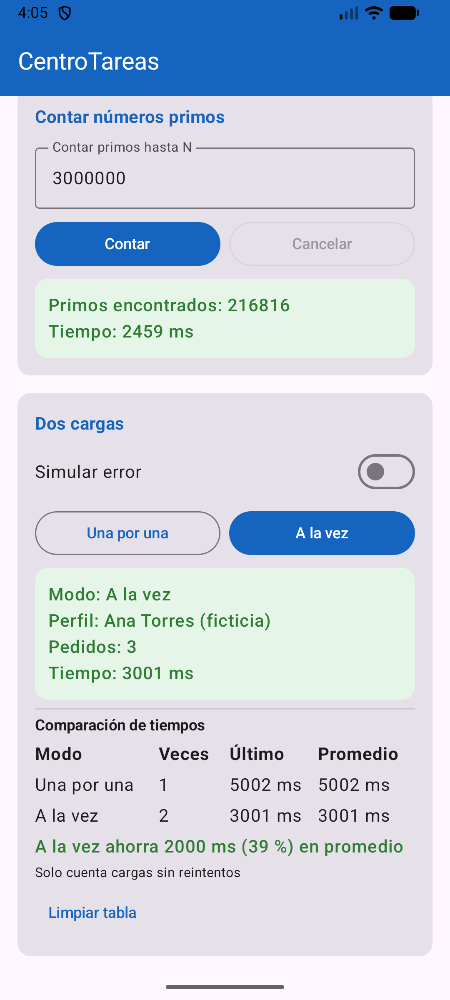

# CentroTareas

**Semana 14 – Hilos en Android** · Programación en Móviles (Tecsup)

CentroTareas es una app que ejecuta tres tipos de trabajo que tardan sin congelar la pantalla:

1. Una **tarea con barra de progreso** que se puede cancelar.
2. Un **cálculo pesado**: contar números primos hasta N, también cancelable.
3. **Dos cargas de datos simuladas** (perfil y pedidos), que se pueden hacer una por una o a la vez con `async`, con manejo de errores y reintento.

Tecnología: Kotlin, Jetpack Compose y Material 3 (sin XML), corrutinas, `ViewModel` y `StateFlow`. Arquitectura **MVVM + Repository**. Todos los datos son ficticios.

## Árbol de paquetes

```
com.tecsup.centrotareas/
├── MainActivity.kt                  Crea el ViewModel con su Factory y muestra la pantalla
├── model/
│   └── Estados.kt                   PrimosUi y CargaUi (estados de pantalla)
├── data/
│   ├── TareasRepository.kt          Interface: contarPrimos, cargarPerfil, cargarPedidos
│   └── TareasRepositoryLocal.kt     Cargas simuladas con delay y conteo de primos
├── viewmodel/
│   ├── TareasViewModel.kt           Lanza las corrutinas y expone StateFlow
│   └── TareasViewModelFactory.kt
└── ui/
    ├── PantallaTareas.kt            Las tres tarjetas (solo muestra estado y avisa eventos)
    └── theme/                       Color.kt, Theme.kt
```

## Diagrama MVVM

```
View (PantallaTareas)
   |  eventos: botones                ^  collectAsState()
   v                                  |
ViewModel (TareasViewModel) ---- StateFlow ---->
   |  viewModelScope.launch { ... }
   v
TareasRepository (interface) ---> TareasRepositoryLocal
                                  (cargas simuladas y contarPrimos)
```

| Capa | Conoce a | No hace |
|---|---|---|
| View (`ui/`) | Solo a su ViewModel | No lanza corrutinas ni usa `Thread`; solo muestra el estado y avisa los eventos |
| ViewModel | Solo a la interface del Repository | No conoce Composables, no recibe `Context` y no bloquea el hilo principal |
| Repository | Nada de la UI | No expone estados de pantalla; sus funciones `suspend` no bloquean a quien las llama |

## Observación del Paso 1

- **Qué pasa con la pantalla:** al tocar *Tarea larga (MAL)* la app se queda congelada unos 4 segundos. El botón *Tócame* no suma, los botones no responden y la pantalla no se redibuja. Pasado ese tiempo, el texto cambia directamente a *Terminó*.
- **Por qué no se ve "Trabajando...":** `tareaLargaMala()` se ejecuta en el hilo principal, que es el mismo que dibuja la pantalla. El mensaje sí cambia a "Trabajando...", pero `Thread.sleep(4000)` bloquea ese hilo antes de que Compose pueda volver a dibujar. Cuando el hilo se libera, el mensaje ya vale "Terminó", así que solo se dibuja ese último valor.
- **Qué pasaría con 10 segundos:** Android mostraría el diálogo **ANR (Application Not Responding)**, "La app no responde", con las opciones de esperar o cerrar la app. Esto ocurre cuando el hilo principal no atiende un toque durante unos 5 segundos.

## Capturas

| Tarea con progreso (74 %) | Tarea cancelada (43 %) |
|---|---|
|  |  |

| Primos hasta 3 000 000 | Error simulado con Reintentar |
|---|---|
|  |  |

| Una por una (≈ 5000 ms) | A la vez (≈ 3000 ms) |
|---|---|
|  |  |

Otras capturas: [corrutina trabajando con el contador sumando (Paso 2)](capturas/paso2_trabajando.png), [primos cancelado](capturas/paso5_cancelado.png) y [tarea terminada después de rotar la pantalla](capturas/rotacion.png).

## Pruebas de aceptación (Paso 8)

Todas se hicieron en el emulador *Medium_Phone*.

| Prueba | Resultado esperado | Resultado obtenido | OK |
|---|---|---|---|
| Tarea larga: tocar *Tócame* mientras trabaja | El contador sigue sumando | El contador sumó mientras decía "Trabajando..." | ✅ |
| Logcat con filtro `HILO` | `main` antes y después; `DefaultDispatcher-worker` dentro | `Antes: main` · `Dentro: DefaultDispatcher-worker-1` · `Despues: main` | ✅ |
| Iniciar la tarea con progreso | La barra avanza de 0 a 100 % en ≈ 4 s | De 0 a 100 % en ≈ 4,3 s | ✅ |
| Cancelar a mitad | La barra se detiene, dice *Cancelado* y se puede iniciar otra vez | Se quedó en 43 % con "Cancelado"; al reiniciar empezó de 0 | ✅ |
| Pulsar *Iniciar* dos veces seguidas | No se lanzan dos tareas | El botón se deshabilita y Logcat muestra una sola corrida | ✅ |
| Primos hasta 1000 | 168 | 168 (también 100 → 25, 10 000 → 1229, 100 000 → 9592, 500 000 → 41 538) | ✅ |
| Primos con N grande | La pantalla no se congela y *Cancelar* funciona | El contador siguió sumando y el estado pasó a "Cancelado" | ✅ |
| Una por una | ≈ 5 s y resultado correcto | 5001 ms · Ana Torres (ficticia) · 3 pedidos | ✅ |
| A la vez | ≈ 3 s y resultado correcto | 3036 ms · Ana Torres (ficticia) · 3 pedidos | ✅ |
| Error simulado + *Reintentar* | Recuadro rojo; al desactivar el interruptor y reintentar, éxito | "No se pudo cargar: Sin conexión"; al reintentar, recuadro verde en 3002 ms | ✅ |
| Rotar la pantalla durante la tarea | La tarea continúa y el progreso no se reinicia | Al girar seguía en 83 % y terminó; una sola corrida en Logcat | ✅ |
| Revisar el código | `git grep` no encuentra `GlobalScope`, `runBlocking` ni `Thread.sleep` | Sin resultados | ✅ |

> **Nota sobre el valor por defecto de N:** en este emulador, contar hasta 500 000 tardaba solo ≈ 0,5 s. La guía pide ajustar el valor para que tarde entre 2 y 5 s, así que el campo empieza en **3 000 000** (≈ 2,3–3,2 s).

## Fase 2 – Mejoras (rama `mejora-ia-s14`)

Son 4 mejoras de la lista de la guía más una propia (la suma de primos) y el diseño visual, cada una en su propio commit. El registro de prompts y decisiones está en [PROMPTS.md](PROMPTS.md).

| # | Mejora | Capas que cambian | Qué hace |
|---|---|---|---|
| 1 | Progreso desde el Repository | Repository + ViewModel | `progresoTarea()` es un `flow { emit(...) }.flowOn(Dispatchers.Default)`; el ViewModel solo hace `collect` |
| 2 | Primos con progreso | Repository + ViewModel + View | `contarPrimos` avisa su avance cada 1 % y la tarjeta muestra la barra con "Calculando... 41 %" |
| 3 | Reintento automático | ViewModel + View | Los pedidos se reintentan hasta 3 veces con espera creciente (500 ms, 1000 ms) y la pantalla muestra cada intento |
| 4 | Comparación de tiempos | ViewModel + View | Tabla con veces, último tiempo y promedio de cada modo, más el ahorro de *A la vez* (≈ 2000 ms, 39 %) |
| 5 | Estilo visual | View | Tarjetas redondeadas con ícono junto al título y paleta azul. Se mantiene la pantalla única de la guía, con las tres tarjetas en orden |

> 🗺️ **[MAPA_DEL_LAB.html](MAPA_DEL_LAB.html)**: página con el archivo y la línea donde está implementado cada requisito (dependencias, hilos, corrutinas, pasos y mejoras). Ábrela en el navegador.

| Primos con progreso | Reintento automático | Tabla comparativa |
|---|---|---|
|  |  |  |

Después de las mejoras se repitieron todas las pruebas de aceptación de la Fase 1 y todas siguen pasando: Logcat `HILO`, cancelar, primos, 5000 ms y 3000 ms, error con Reintentar y rotación.

## Para pensar

**1. ¿Por qué no se veía "Trabajando..." en el Paso 1?**
Porque todo pasaba en el hilo principal. Se cambiaba el mensaje, pero `Thread.sleep` bloqueaba ese mismo hilo, que es el que dibuja la pantalla. Compose no tuvo la oportunidad de redibujar hasta que terminó la espera, y para entonces el mensaje ya era "Terminó".

**2. ¿Qué diferencia hay entre `Thread.sleep` y `delay`?**
`Thread.sleep` **bloquea el hilo** completo: nadie más puede usarlo mientras espera. `delay` es una función `suspend` que **suspende solo la corrutina** y libera el hilo para que haga otras cosas (por ejemplo, dibujar la pantalla). Además, `delay` revisa la cancelación: si cancelan el `Job`, la espera se corta enseguida.

**3. ¿Por qué `Dispatchers.Default` para los primos y `Dispatchers.IO` para la red?**
Contar primos es trabajo de **CPU**. `Default` tiene tantos hilos como núcleos del procesador, que es lo ideal para cálculos. La red o el disco son trabajo de **espera** (el hilo está casi todo el tiempo esperando una respuesta), y `IO` tiene un grupo de hilos más grande, pensado para que muchas esperas en paralelo no se queden sin hilos.

**4. ¿Qué pasaría con la corrutina si el usuario cierra la pantalla? ¿Qué papel cumple `viewModelScope`?**
`viewModelScope` está atado al ciclo de vida del ViewModel. Si el usuario sale de la pantalla y el ViewModel se destruye (`onCleared`), todas las corrutinas de ese scope **se cancelan solas**, así no quedan trabajos huérfanos ni fugas de memoria. Si solo se rota la pantalla, el ViewModel sobrevive y la corrutina sigue; por eso el progreso no se reinicia al girar.

**5. ¿Por qué `async` tarda 3 s y no 5 s? ¿Qué pasa si una de las dos cargas falla?**
Con `async` las dos cargas empiezan al mismo tiempo, así que el tiempo total es el de la más lenta: máximo(2 s, 3 s) ≈ 3 s. Una por una se suman: 2 s + 3 s ≈ 5 s. Si una falla, `coroutineScope` **cancela la otra** y relanza la excepción en `await()`. El `try/catch` del ViewModel la atrapa y muestra el estado de error con *Reintentar*. La `CancellationException` se vuelve a lanzar para no romper la cancelación.
