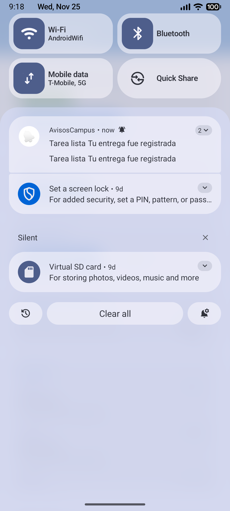
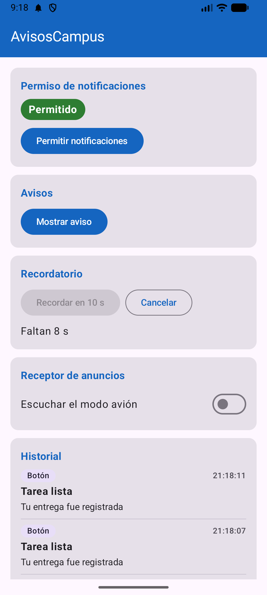
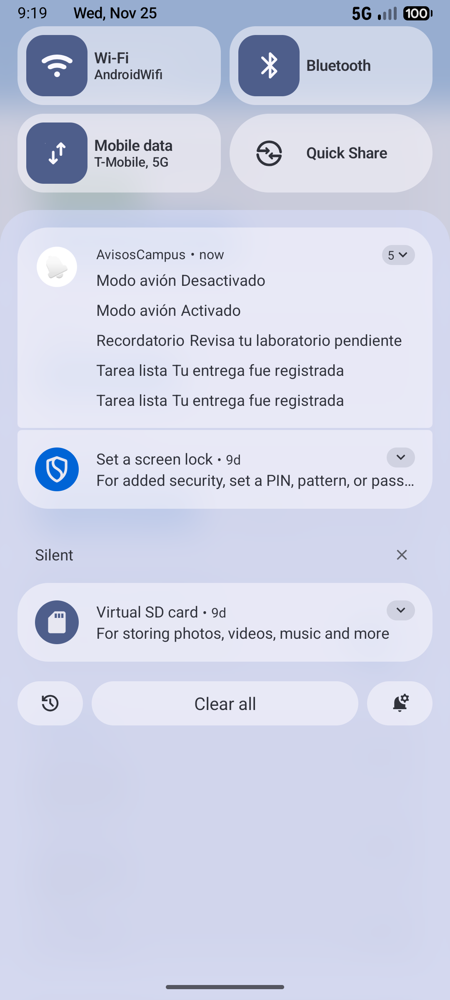
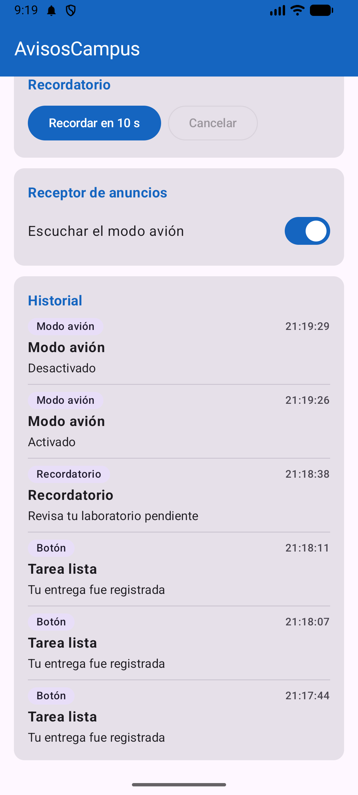
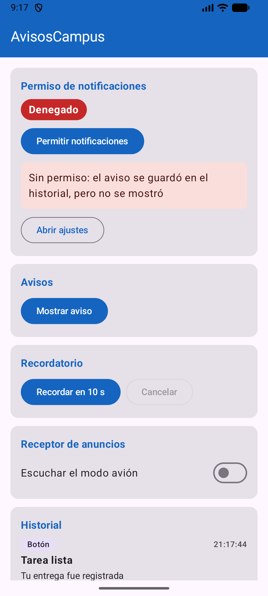

# AvisosCampus

App Android que muestra **notificaciones locales** y escucha el **modo avión** con un `BroadcastReceiver`.
Permite enviar un aviso al instante, programar un recordatorio con cuenta regresiva, recibir un aviso
cuando cambia el modo avión y revisar todo en un historial. Si el usuario niega el permiso de
notificaciones, la app sigue funcionando y ofrece abrir los Ajustes.

**Tecnologías:** Kotlin · Jetpack Compose · Material 3 · MVVM + Repository · Corrutinas (`StateFlow` / `SharedFlow`)

## Autor

| | |
|---|---|
| **Alumno** | Amore Salcedo Macedo |
| **Curso** | Programación en Móviles — 4to ciclo |
| **Docente** | Juan León S. |

## Estructura de paquetes

```
app/src/main/
├── AndroidManifest.xml              # permiso POST_NOTIFICATIONS y android:name=".AvisosApp"
├── java/com/tecsup/avisoscampus/
│   ├── AvisosApp.kt                 # Application: crea el canal "avisos" al iniciar
│   ├── MainActivity.kt              # setContent + ViewModel vía Factory
│   ├── model/
│   │   └── Modelos.kt               # Origen, Aviso, PermisoUi
│   ├── data/
│   │   └── AvisosRepository.kt      # interfaz + AvisosRepositoryMemoria (StateFlow)
│   ├── viewmodel/
│   │   ├── AvisosViewModel.kt       # estado y eventos (sin Context)
│   │   └── AvisosViewModelFactory.kt
│   ├── notificacion/
│   │   └── Notificador.kt           # canal, permiso, NotificationCompat y PendingIntent
│   ├── receiver/
│   │   └── ModoAvionReceiver.kt     # BroadcastReceiver de ACTION_AIRPLANE_MODE_CHANGED
│   └── ui/
│       ├── PantallaAvisos.kt        # pantalla principal con las tarjetas
│       ├── HistorialAvisos.kt       # tarjeta "Historial"
│       └── theme/
│           ├── Color.kt
│           └── Theme.kt
└── res/
    ├── drawable/ic_notificacion.xml # campana del ícono pequeño
    └── values/ (strings.xml, themes.xml)
```

## Arquitectura MVVM

```
┌──────────────────────────── VIEW (Compose) ────────────────────────────┐
│ PantallaAvisos + HistorialAvisos                                       │
│   · botones / switch ──────────────► llaman funciones del ViewModel    │
│   · collectAsState(): avisos, permiso, faltan, escuchandoAvion, mensaje│
│   · LaunchedEffect: collect(vm.eventos) ──► Notificador.mostrar(...)   │
│   · DisposableEffect: registra / quita ModoAvionReceiver               │
└───────────┬──────────────────────────────────────────▲─────────────────┘
            │ avisarAhora(), recordarEn(10),           │ StateFlow (estado)
            │ alCambiarModoAvion(activo),              │ SharedFlow (eventos)
            │ permisoRespondido(), noSePudoMostrar()   │
┌───────────▼──────────────────── VIEWMODEL ───────────┴─────────────────┐
│ AvisosViewModel  (sin Context, sin NotificationManager, sin Receiver)  │
│   · registra el aviso en el repositorio                                │
│   · emite el aviso en _eventos (MutableSharedFlow)                     │
│   · recordatorio: Job en viewModelScope + delay(1000)                  │
└───────────┬──────────────────────────────────────────▲─────────────────┘
            │ registrar(titulo, texto, origen)         │ avisos: StateFlow
┌───────────▼─────────────────── REPOSITORY ───────────┴─────────────────┐
│ AvisosRepositoryMemoria: lista en MutableStateFlow, lo nuevo arriba    │
└────────────────────────────────────────────────────────────────────────┘

 Fuera del MVVM (necesitan Context, los usa solo la View):
   Notificador ──► NotificationManagerCompat.notify(aviso.id, ...)  → panel de Android
   ModoAvionReceiver.onReceive ──► callback ──► vm.alCambiarModoAvion(activo)
```

**Flujo de un aviso:** botón / recordatorio / modo avión → `ViewModel` registra en el `Repository`
→ emite el `Aviso` por `eventos` → la `View` lo recibe y llama a `Notificador.mostrar` → si devuelve
`false` (sin permiso), la View llama a `vm.noSePudoMostrar()` y aparece el mensaje de error.

## Capturas

Tomadas en el emulador (Android API 37).

| 1. Notificación en el panel | 2. Recordatorio con cuenta regresiva | 3. Aviso del modo avión |
|:---:|:---:|:---:|
|  |  |  |
| Dos avisos "Tarea lista" con ids distintos: no se reemplazan. | "Faltan 8 s": Recordar desactivado y Cancelar activo. | El receptor generó "Activado" y "Desactivado". |

| 4. Historial de avisos | 5. Permiso denegado |
|:---:|:---:|
|  |  |
| Lo más reciente arriba, con origen y hora. | Mensaje de error y botón "Abrir ajustes"; el aviso igual queda en el historial. |

## Para pensar

> ⚠️ **BORRADORES — pendientes de revisión por el autor.** Las respuestas son una primera versión
> basada en lo implementado; deben revisarse y redactarse con palabras propias antes de entregar.

**1. ¿Por qué una notificación necesita un canal y un permiso? ¿Qué pasa si falta cada uno?**
*Borrador:* Desde Android 8 toda notificación pertenece a un canal, que permite al usuario controlar
sonido e importancia por tipo de aviso; sin canal, la notificación no se muestra. Desde Android 13 además
se necesita `POST_NOTIFICATIONS`; sin él, `notify` no muestra nada. Por eso `Notificador.mostrar` revisa
el permiso y devuelve `false` en lugar de fallar.

**2. ¿Por qué el ViewModel emite un evento y no muestra la notificación él mismo?**
*Borrador:* Mostrar una notificación necesita `Context`, y el ViewModel no debe guardarlo porque vive
más que la Activity (se filtraría memoria) y sería difícil de probar. El ViewModel solo decide *qué*
aviso hay y lo emite por un `SharedFlow`; la View, que sí tiene `Context`, lo convierte en notificación.

**3. ¿Qué pasa si usas el mismo id en dos notificaciones?**
*Borrador:* Android reemplaza la notificación anterior por la nueva en vez de mostrar dos. En la app se
usa `aviso.id` (que el repositorio incrementa desde 1), así cada aviso aparece como una notificación
distinta en el panel.

**4. ¿Por qué `onReceive` debe ser corto y por qué hay que quitar el receptor al salir?**
*Borrador:* `onReceive` corre en el hilo principal y el sistema lo corta si tarda demasiado (puede
provocar un ANR). Por eso `ModoAvionReceiver` solo lee el estado y llama al callback. Hay que quitarlo
con `unregisterReceiver` (en `onDispose`) porque si queda registrado sigue recibiendo anuncios y retiene
la pantalla en memoria aunque ya no exista.

**5. ¿En qué casos usarías una notificación local y en cuáles una push de Firebase?**
*Borrador:* La local se usa cuando el aviso nace en el propio teléfono: un recordatorio, el fin de una
tarea o un cambio del sistema como el modo avión. La push (Firebase Cloud Messaging) se usa cuando el
aviso viene de un servidor y debe llegar aunque la app esté cerrada, por ejemplo un anuncio del docente
para todos los alumnos o una nota publicada.
